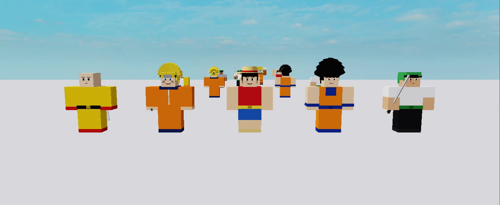
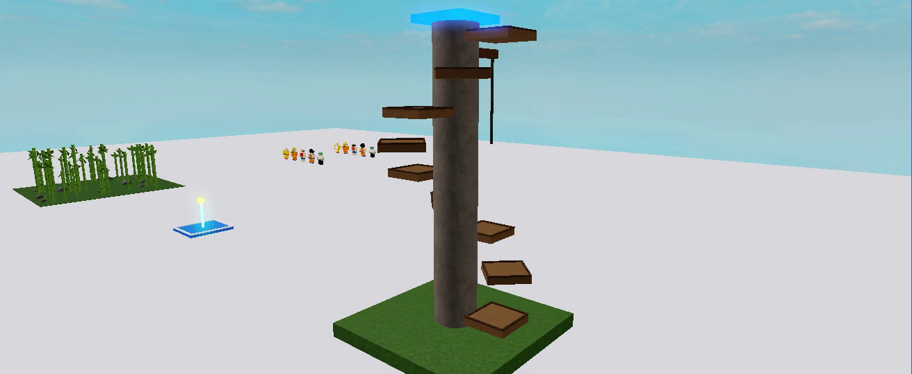
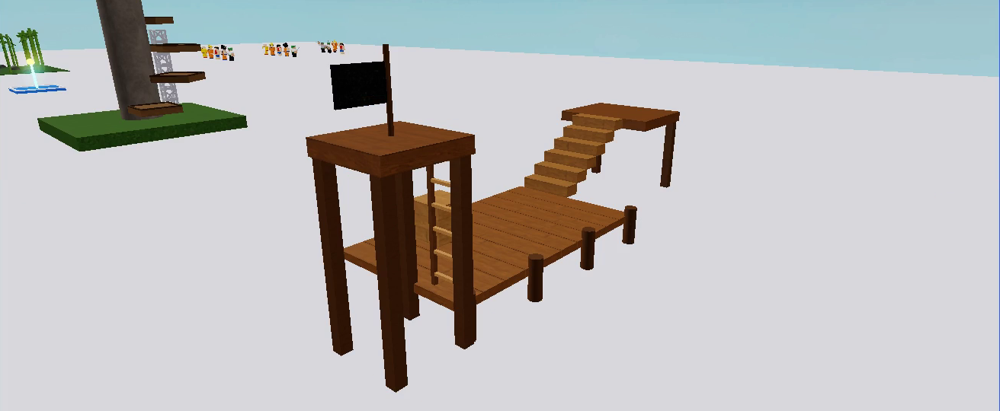
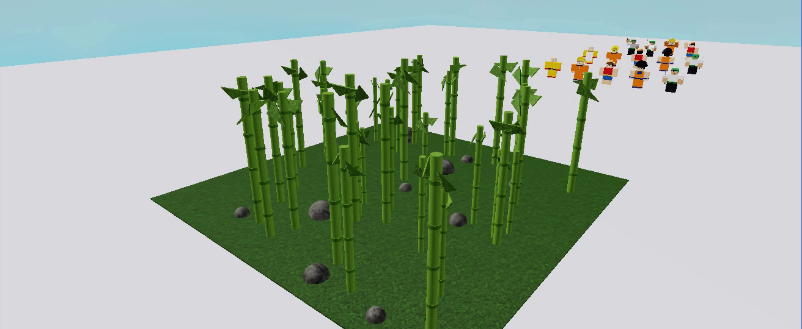
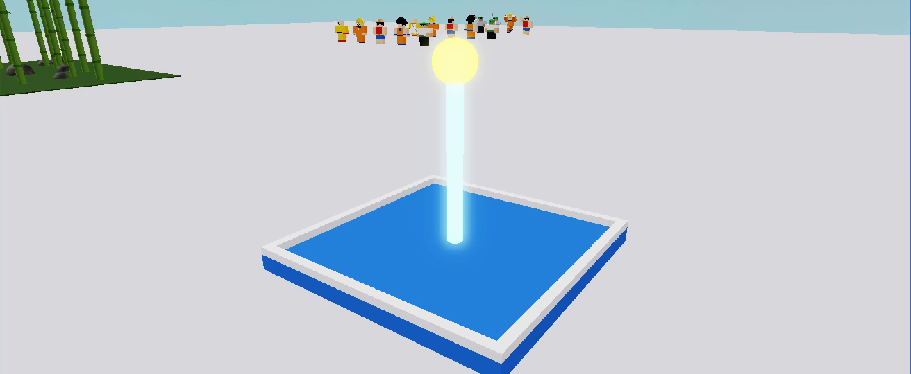
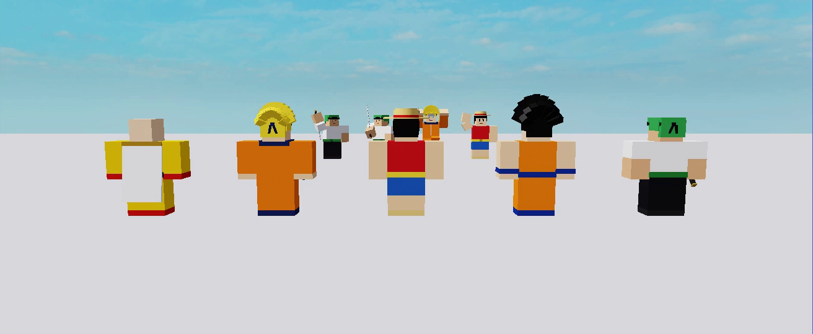
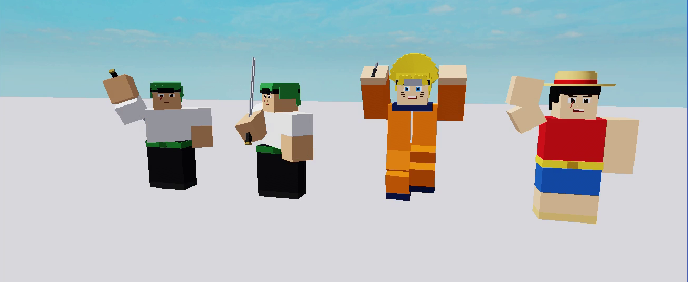

# roblox-harness

**English** · [한국어](README.ko.md)

Declarative generation harnesses for Roblox, written in strict Luau. Describe a stage piece or a
blocky R15 character as a plain table (or JSON), get a validated, deterministic Instance tree back —
in Studio, at runtime, or headless in [Lune](https://lune-org.github.io/docs) for CI and `.rbxm` export.



| Harness | What it builds |
| --- | --- |
| `Harness.Object` | Parts, wedges, platforms (with trim), truss columns, climbable ropes, ladders, stairs, nested models, arrays, seeded scatters, prefabs — with colors, materials, anchoring, `WeldConstraint`s, pivots, attributes and tags. |
| `Harness.Character` | A blocky R15 rig (15 parts + root, standard `Motor6D` names) plus a look: face, hair, outfit, accessories, weapons and free-form custom pieces, all welded to the right body part. |
| `Harness.Anim` | Keyframe animation authoring: validate, sample (pure), pose a rig, mirror left/right, and emit a `KeyframeSequence` with markers. |

## Install

* **Rojo:** add `src/Harness` to your project tree (e.g. under `ReplicatedStorage.Harness`), or
* **Model file:** `rojo build default.project.json -o Harness.rbxm` and drag it into Studio.

Toolchain versions are pinned in `aftman.toml` (`aftman install`).

## Object harness

```lua
local Harness = require(game.ReplicatedStorage.Harness)

local tower = Harness.Object.build({
	name = "JumpTower",
	seed = 7,                                   -- drives every scatter; same seed => same layout
	prefabs = {
		Ledge = { kind = "platform", size = { 6, 1, 6 }, color = "#7a5c3a", material = "WoodPlanks", trim = 1 },
	},
	children = {
		{ kind = "part", name = "Base", size = { 24, 2, 24 }, pos = { 0, 1, 0 }, color = "grass", material = "Grass" },
		{ kind = "array", count = 8, offset = { 0, 4.5, 0 }, rotStep = { 0, 45, 0 },
		  item = { kind = "use", prefab = "Ledge", pos = { 7, 4, 0 } } },
		{ kind = "truss", height = 14, pos = { -4, 2, -6 } },
		{ kind = "rope", length = 12, segments = 6, pos = { 6, 40, 6 } },   -- hangs down from pos
		{ kind = "model", name = "Crates", anchored = false, weld = "all", children = { ... } },
	},
}, workspace, { origin = CFrame.new(0, 0, 0) })
```

| Kind | Required | Notes |
| --- | --- | --- |
| `part` | – | `size`, `shape` = `Block`/`Cylinder`/`Ball` |
| `wedge`, `cornerwedge` | `size` | |
| `platform` | `size` | `trim` (0..5) adds a darker non-colliding lip; `trimColor` |
| `truss` | `height` | snaps to multiples of 2 (as Roblox does); stands on `pos`; `style` |
| `rope` | `length` | invisible climbable `TrussPart` + `segments` visible cylinders; `thickness`, `knotColor` |
| `ladder` | `height` | rails + rungs every `rungSpacing`, invisible truss for climbing |
| `stairs` | `steps` | `rise`, `run`, `width`; climbs toward −Z |
| `model` | – | `children`, `pivot`, `weld = "all"`, `anchored` is inherited |
| `array` | `count`, `item` | `offset` and `rotStep` per copy, names `Item_001…` |
| `scatter` | `count`, `area`, `item` | seeded per scatter, `jitterRot`, `scaleRange` (scales prefabs recursively) |
| `use` | `prefab` | instance a prefab; fields on the `use` node override it |

Common fields: `name`, `pos`, `rot` (degrees), `color` (`#rrggbb`, a palette name, or `{r,g,b}` 0–255),
`material` (any `Enum.Material` name), `anchored`, `canCollide`, `transparency`, `reflectance`,
`castShadow`, `attributes`, `tags`.

**Validation** reports *every* problem with a path (`spec.children[3].size: component 2 must be > 0`):
unknown kinds/fields (typos), bad enums, NaN/inf, non-positive sizes, sparse lists, prefab cycles,
nesting depth, and an up-front part-count estimate against `limits` (`maxParts` 20 000,
`maxCount` 2 000, `maxDepth` 32 — override per spec with `limits = { ... }`).
`Object.validate(spec)` returns `ok, errors, estimatedParts` without building.

**Determinism:** output depends only on the spec. Children keep spec order, generated names are
zero-padded, scatters use a private xorshift RNG (not `Random`), so builds are identical across
Studio, servers and Lune. Editing one scatter never reshuffles another.

## Character harness

```lua
local hero = Harness.Character.build({
	name = "SwordRonin",
	skin = "#d9a77c",
	outfit = { shirt = "#f2f2ee", pants = "#1d1d22", shoes = "#2a2a2a", sleeves = "short" }, -- none|short|long, legs = long|shorts
	face = { eyes = "sharp", mouth = "flat", browTilt = 22, scar = true },                  -- eyes round|sharp|closed, mouth smile|grin|frown|flat
	hair = { style = "short", color = "#3f9a52" },                                        -- bald|short|spiky|long|ponytail|afro
	accessories = { { type = "headband", color = "#1d1d22" }, { type = "belt" } },        -- strawHat|headband|scarf|cape|belt|shoulderPads|glasses|backpack
	weapons = { { type = "katana", hand = "Right", length = 3.4 } },                      -- katana|staff|shield|hammer|kunai
	pieces = { { attach = "Head", name = "Horn", size = { 0.2, 0.6, 0.2 }, pos = { 0.3, 0.7, 0 }, color = "red", shape = "Wedge" } },
}, { origin = CFrame.new(0, 0, 0) })
hero.Parent = workspace
```

* Rig: feet on y = 0, facing −Z, `HumanoidRootPart` anchored, standard R15 joint names
  (`Root`, `Waist`, `Neck`, `RightShoulder`, …) with C0/C1 computed from joint points, `scale` 0.25–4.
* Look pieces are positioned in **body-part space** (Head is 1.2³ centred at 0, face plane at z = −0.6),
  massless, non-colliding, welded with `Weld` (C0 = offset) so they follow animations. They are grouped
  under `Model.Look/<Face|Hair|Acc01_cape|Weapon01_katana|Custom>`.
* `Character.pieces(spec)` returns the expanded piece list as pure data (tools, tests, diffing).

## Animation helper

```lua
local Anim = Harness.Anim
local slash = {
	name = "Slash", length = 0.8, priority = "Action",
	keys = {
		{ t = 0,    poses = { RightUpperArm = { rot = { 0, 0, 0 } } } },
		{ t = 0.2,  ease = "Cubic", dir = "Out", poses = { RightUpperArm = { rot = { 160, 0, 20 } } } },
		{ t = 0.35, poses = { RightUpperArm = { rot = { 60, 0, -30 } } } },
		{ t = 0.8,  poses = { RightUpperArm = { rot = { 0, 0, 0 } } } },
	},
	markers = { { t = 0.3, name = "Hit", value = "slash" } },
}
local ks = Anim.toKeyframeSequence(slash)  -- nested R15 Pose tree, easing, KeyframeMarkers; publish with the Animation Editor
Anim.apply(hero, slash, 0.2, "C0")         -- edit-mode preview ("Transform" at runtime)
local cf = Anim.sample(slash, "RightUpperArm", 0.25) -- pure sampling for tests
local left = Anim.mirror(slash.keys[2].poses)        -- swap Left*/Right*
```

Easing: `Linear`, `Constant`, `Cubic`, `Bounce`, `Elastic` × `In`/`Out`/`InOut`; like Roblox, the
previous keyframe's easing shapes each segment and keys without a pose for a part are skipped.

## Lune (headless) and export

```sh
lune run tools/build.luau object examples/objects/JumpTower.lua out/JumpTower.rbxm
lune run tools/build.luau character examples/characters/FoxNinja.lua out/FoxNinja.rbxm
lune run tools/build.luau anim examples/anims/Slash.lua out/Slash.rbxm
lune run tools/export_examples.luau   # every example -> out/*.rbxm
lune run tools/preview_place.luau     # out/harness_preview.rbxlx with a scripted camera tour (press Play)
rojo build examples.project.json -o examples.rbxlx  # place that builds the examples in-engine
```

`tools/load.luau` lets Lune run the same `require(script.Parent.X)` modules Studio uses, so there is a
single code path. Specs can be `.lua` tables or `.json` files.

## Checks

`./check.sh` runs what CI runs: selene, `rojo build` (library + example place), `luau-lsp analyze`
(strict mode), the Lune test suite (88 tests plus a 3 000-spec fuzz pass: validation, every kind and preset, transforms,
determinism fingerprints, rbxm round-trips, perf with 10 000-part and 1 000-piece specs) and the
example export. GitHub Actions runs it on every push and PR.

## Examples

| | |
| --- | --- |
|  JumpTower — spiral ledges, truss, rope, checkpoint |  PirateDock — planks, stairs, ladder, welded crates |
|  BambooGrove — seeded scatter of welded prefabs |  CheckpointPad — a JSON spec |
|  Back view of the lineup |  Slash / JumpClimb / Wave samples posed with `Anim.apply` |

The example characters are original parody archetypes (no logos or trademarked names).

## Limits

* Blocky parts only — no MeshParts, SpecialMeshes, textures or decals yet.
* Clothing is colour-blocking on body parts, not Shirt/Pants images.
* `KeyframeSequence` must still be published via the Animation Editor to get an asset id.
* Lune cannot run physics, so welds and climbing are verified in Studio, not in CI.

## License

[MIT](LICENSE)
